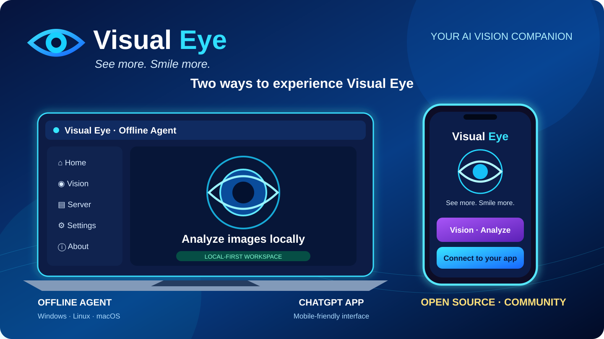

# Visual Eye — See more. Smile more.

  

  <strong>Two ways to experience Visual Eye.</strong> 
  Explore images with the local-first Offline Agent, or use the mobile-friendly ChatGPT companion.

  <a href="https://github.com/mohammadhosseinazad/visual-eye-offline-agent-Description/releases">Offline Agent releases</a>
  &nbsp; · &nbsp;
  <a href="https://github.com/mohammadhosseinazad/visual-eye-touch-mcp-app">ChatGPT App source</a>

**Created by:** Muhammad-Hossein Azad · **Contact:** mohammadhosseinazad3@gmail.com

## Choose your Visual Eye

| Visual Eye Offline Agent | Visual Eye ChatGPT App |
|---|---|
| Local-first image-analysis workspace for Windows, Linux, and macOS. | Mobile-friendly companion interface for the Visual Eye workflow in ChatGPT. |
| Python application with local UI, analysis engine, setup scripts, guides, and tests. | Separate MCP app project; requires the supported ChatGPT app/connector setup. |
| [Offline Agent release downloads](https://github.com/mohammadhosseinazad/visual-eye-offline-agent-Description/releases) | [Download ChatGPT App source ZIP](https://github.com/mohammadhosseinazad/visual-eye-touch-mcp-app/archive/refs/heads/main.zip) |

**Download status:** The GitHub releases page is the intended public distribution point for the Offline Agent ZIP and checksums; release assets have not yet been attached. The ChatGPT App source is maintained in its separate repository. Please do not mistake the current documentation repository ZIP for the complete Offline Agent installer.

## Offline Agent — v1.3 Beautiful UI

The v1.3 source archive has been recovered and validated in the project workspace. It includes the Persian interface, English UI preview, analysis engine, setup scripts, Docker files, guides, and tests. The source tree is not yet committed here as individual repository files or as a GitHub release asset.

Validation performed in the available Linux/Python 3.13 environment:
- Python compilation
- `SELF_TEST.py`
- `E2E_TEST.py`
- `SECURITY_TEST.py`
- `SESSION_SECURITY_TEST.py`

These checks do not certify cross-platform compatibility, independent security, or production readiness.

## Capabilities

- Local web interface, normally at `http://127.0.0.1:8765`
- Quick, Deep, and Custom analysis workflows
- Image validation and local session state
- Design recommendations and local output generation
- Optional local vision analysis through Ollama
- Optional image-generation/editing integration through ComfyUI
- Docker Compose files and Windows/Linux/macOS helper scripts

The built-in analysis and design outputs are not equivalent to generative pixel-level image editing. Generative editing requires a separately installed and configured ComfyUI service, a compatible workflow, and model assets.

## Important security limitation

The built-in Offline Agent HTTP server does not provide user authentication or TLS. It is intended for localhost use only. Do not expose it to a LAN or the public internet. Keep the bind address at `127.0.0.1`.

## Offline operation

The source archive does not include Python wheel bundles, container images, Ollama model blobs, ComfyUI installation, or model weights. A truly offline deployment requires preparing and verifying all platform-specific dependencies and model assets separately.

## Licensing

The original Visual Eye project materials include an Apache License 2.0. Third-party software, models, assets, and custom nodes retain their own licenses; redistribution review is still required.

## Downloads

- [Download both Visual Eye editions](DOWNLOADS.md)

## Documentation

- [Server Setup & Auto Connect specification](docs/SERVER_SETUP_AND_AUTO_CONNECT.md)
- [Project handover and adoption checklist](docs/PROJECT_HANDOVER.md)
- [Product scope and capability boundaries](docs/PRODUCT_SCOPE_AND_CAPABILITIES.md)
- [Architecture and data flow](docs/ARCHITECTURE.md)
- [Deployment and operations runbook](docs/DEPLOYMENT_AND_OPERATIONS.md)
- [Security and privacy guidance](docs/SECURITY_AND_PRIVACY.md)
- [QA matrix and release process](docs/QA_AND_RELEASE_PROCESS.md)
- [Known release blockers](RELEASE_BLOCKERS.md)
- [Preliminary third-party license review](THIRD_PARTY_LICENSE_REVIEW.md)

*See more. Smile more.* ❤️
