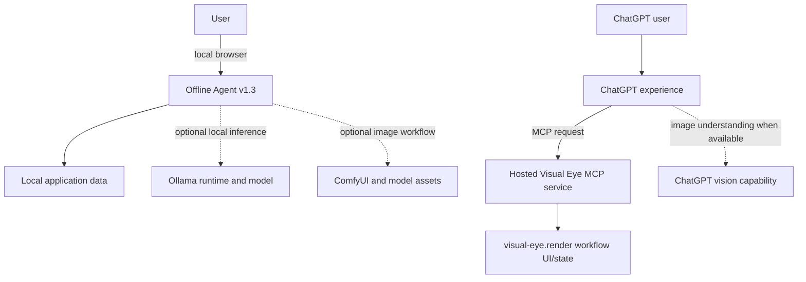

# Architecture and Data Flow

## High-level system map

This is a conceptual diagram, not a deployment manifest. The Offline Agent and hosted MCP service are separate deliverables.

## Offline Agent data flow

1. The user opens the local web UI.
2. The user selects/uploads an image through the local application.
3. The application validates the image and manages local session state.
4. Analysis and recommendations are produced by the application's built-in workflow and, when configured, the local Ollama model.
5. Optional generative image workflows are delegated to a separately installed ComfyUI service.
6. Uploaded images, outputs, and session history are stored in the application's local data directory.

The current application does not provide a complete in-app retention manager. The built-in HTTP server has no user authentication or TLS and is intended to bind to loopback only.

## Hosted MCP data flow

1. ChatGPT connects to the hosted MCP endpoint.
2. The MCP service exposes the `visual-eye.render` tool and the touch-first workflow UI/state.
3. The ChatGPT experience handles any attached image understanding using its own available capabilities.
4. The MCP service should not be described as receiving or processing image bytes unless the implementation is changed and verified.

Known endpoints:
- `https://visual-eye-v.onrender.com/mcp`
- `https://visual-eye-v.onrender.com/healthz`

## Deployment boundaries

- Offline Agent local web server: keep bound to `127.0.0.1`; do not expose directly to LAN or public internet.
- Ollama and ComfyUI: separate services; secure their listening interfaces and credentials independently.
- Hosted MCP: Render-managed service; review environment variables, logs, access, and deployment history in Render.
- Secrets: never commit tokens, API keys, passwords, private certificates, or production environment files to Git.

## Unknowns requiring source-level confirmation

The exact module map, internal API contracts, persistence schema, environment-variable inventory, dependency lockfiles, and container topology must be confirmed against the complete source archive before a company relies on this document as an implementation specification.